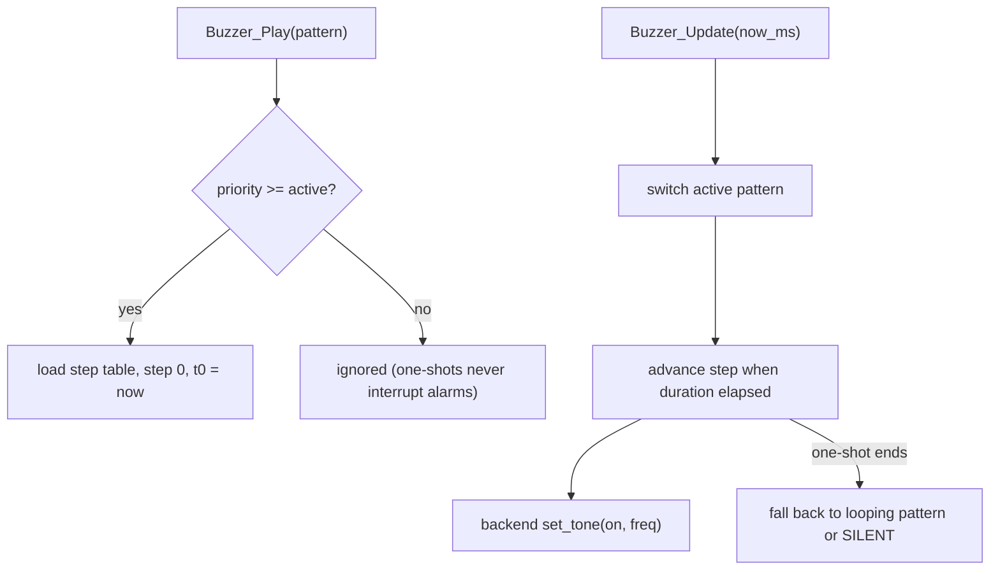

# Task 3 - Buzzer Pattern Controller

## Context

From [docs/Darren's_Tasks.md](docs/Darren's_Tasks.md) Task 3 and [docs/Assignment2_Enhancements.md](docs/Assignment2_Enhancements.md), the buzzer needs six behaviours: threat chirp, laser-fire tone, 2 Hz LAST_OF_2028 warning, accelerating countdown beeps, final burst, then silence. Same style as Task 2: `HAL_StatusTypeDef`-free pure logic, `Buzzer_Update(now_ms)`, no `HAL_Delay`.

Hardware facts found:

- Buzzer on **D2 = PD14** (`ARD_D2_Pin` / `ARD_D2_GPIO_Port` in the lab `main.h`).
- CubeMX currently configures PD14 as an **EXTI rising input** (lab `main.c` line ~863). The test harness must re-init it as a push-pull output in a USER CODE block (no `.ioc` edit), default LOW.
- Buzzer type is unknown, so the design uses a backend callback; PD14 is also `TIM4_CH3` (AF2) if PWM is needed later.

## Pattern model

```c
typedef enum {           /* higher value = higher priority */
    BUZZER_PATTERN_SILENT = 0,
    BUZZER_PATTERN_THREAT_CHIRP,   /* one-shot: 2 short chirps */
    BUZZER_PATTERN_LASER_FIRE,     /* one-shot: ~300 ms tone (falling pitch if passive) */
    BUZZER_PATTERN_LAST_WARNING,   /* loop: 2 Hz, 250 on / 250 off */
    BUZZER_PATTERN_COUNTDOWN,      /* loop: interval shrinks with value 10..0 */
    BUZZER_PATTERN_FINAL_BURST,    /* one-shot: ~1 s rapid burst, then latch silent */
    BUZZER_PATTERN_COUNT
} BuzzerPattern_t;
```

Each fixed pattern is a const step table `{ on, freq_hz, duration_ms }` plus a `loop` flag. `Buzzer_Update` uses a `switch (active_pattern)` only for the special cases (COUNTDOWN computes its step duration from the countdown value; FINAL_BURST latches `terminated`), and a shared step-walker for the rest.




Arbitration rules:

- One-shots (chirp, fire) play only if no higher alarm is running; when done, revert to the looping pattern underneath (e.g. stays SILENT in battle).
- `Buzzer_SetCountdown(h, value_0_10)` updates the countdown cadence live: beep 60 ms, gap = `60 + value * 80` ms (~860 ms at 10, ~60 ms at 0), aligning with the matrix flash.
- `Buzzer_Stop(h)` (rescue) clears everything to SILENT; FINAL_BURST latches silence until `Buzzer_Reset`.

## Hardware-neutral backend

```c
typedef struct {
    void (*set_tone)(void *ctx, uint8_t on, uint16_t freq_hz); /* freq ignored if active */
    void *ctx;
} Buzzer_Backend_t;
```

- Active buzzer backend (test file): `HAL_GPIO_WritePin(ARD_D2_GPIO_Port, ARD_D2_Pin, on)`.
- Passive backend: deferred. If testing shows the buzzer is passive, add a TIM4_CH3 PWM backend later; pattern tables already carry `freq_hz`.
- The controller only calls the backend on a state change, so no GPIO spam.

## New files

- [App/Inc/buzzer.h](App/Inc/buzzer.h) - enum, step struct, backend, handle, API
- [App/Src/buzzer.c](App/Src/buzzer.c) - step tables, arbiter, switch-case update
- [App/Test/buzzer_test.c](App/Test/buzzer_test.c) - GPIO backend on PD14 + UART menu

API:

```c
void Buzzer_Init(Buzzer_HandleTypeDef *h, const Buzzer_Backend_t *backend);
void Buzzer_Play(Buzzer_HandleTypeDef *h, BuzzerPattern_t pattern);
void Buzzer_SetCountdown(Buzzer_HandleTypeDef *h, uint8_t value_0_10);
void Buzzer_Stop(Buzzer_HandleTypeDef *h);
void Buzzer_Reset(Buzzer_HandleTypeDef *h);
void Buzzer_Update(Buzzer_HandleTypeDef *h, uint32_t now_ms);
```

## Test harness

`buzzer_test.c` re-inits PD14 as output LOW, then a UART menu (COM6 @ 115200, same non-blocking `HAL_UART_Receive(..., 0)` style):

- `t` : continuous ON for 1 s (type ID: steady tone = active; faint click = passive)
- `c` chirp, `f` fire, `w` 2 Hz warning, `k` countdown 10..0 auto-stepped each second, `x` final burst, `z` stop, `h` menu

To keep the existing matrix test working, the buzzer menu keys are chosen not to collide with the Task 2 menu, and `main.c` calls both `StatusDisplay_Test_Update` and `Buzzer_Test_Update`. Simpler alternative: only one UART owner; the buzzer test reads keys forwarded from the status test. Plan: give `Buzzer_Test_HandleKey(ch)` and call it from `StatusDisplay_Test_Update`'s default case, so there is only one UART reader.

## Integration (lab project)

- Copy files into `EE2028_Project_Test/Core/Src` and `Core/Inc`, add to `Debug/Core/Src/subdir.mk` and `objects.list` as for Task 2.
- In `main.c` USER CODE: `Buzzer_Test_Init(&hbuzzer);` after inits; `Buzzer_Update(&hbuzzer, HAL_GetTick());` in the loop.
- Build with CubeIDE make, flash, run `scripts/serial_monitor.ps1`.

## Documentation

- Tick Task 3 items in [docs/Darren's_Tasks.md](docs/Darren's_Tasks.md) once verified.
- Add a buzzer section (patterns, timings, backend, D2 wiring, active/passive result) to a new `docs/Buzzer_Design.md`.

## Checklist

- Hardware-neutral backend callback
- Threat chirp, laser fire, 2 Hz warning, accelerating countdown, final burst + silence
- Priority arbitration via enum, special cases via switch-case
- Non-blocking `Buzzer_Update(now_ms)`
- Active buzzer works on PD14; passive path left ready (freq in tables, TIM4_CH3)

