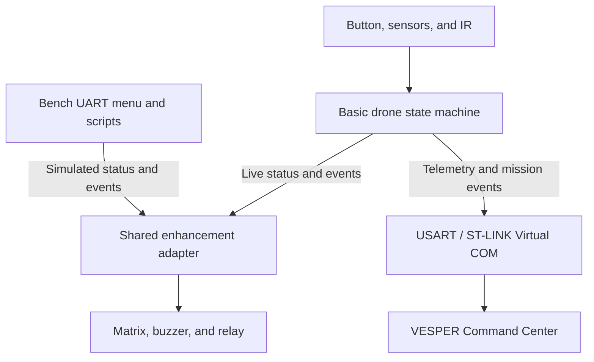

# EE2028 unified integration plan

## 1. Current integration issues

PR #3 contains the basic drone state machine. The enhancement bench demo drives the matrix, buzzer, IR sensor, and relay with its own inputs and timing. The integration work is to connect those modules to the real drone while keeping the bench demo available for testing.

| Issue                              | What needs to be resolved                                                                                                                                                                                                                                                 |
| ---------------------------------- | ------------------------------------------------------------------------------------------------------------------------------------------------------------------------------------------------------------------------------------------------------------------------- |
| **Two countdowns**                 | PR #3 commits to self-destruct after 10 seconds or five failed rescues, whichever comes first. The matrix demo runs a 10-second banner and then an 11-second countdown. A live display could start counting as the drone shuts down.                                      |
| **Relay tied to the demo**         | The relay test harness reacts to the matrix’s explosion animation. PR #3’s actual self-destruct path never calls it. The firmware also halts after its final messages, so any local effects still running would stop receiving updates.                                   |
| **Conflicting gameplay rules**     | The baseline checklist describes automatic fire at `5/10`. PR #3 implements hold-to-fire. The docs also disagree on what *armed* means and whether sensor thresholds or IR can trigger Battle. Check the original assignment brief before changing these rules.           |
| **Button timing and display I/O**  | PR #3 processes the button before checking rescue expiry, and its gesture logic uses raw polled GPIO despite the EXTI debounce. The matrix driver uses synchronous I²C with a 100 ms timeout per transfer. A display fault could increase the gap between button samples. |
| **Board / Cube incomplete**        | Board of record is **B-L4S5I-IOT01A**; PR #3 BSP paths (`B-L4S5I-IOT01` / `stm32l4s5i_iot01*`) match. The checkout still lacks the complete CubeIDE project (handles / generated `ARD_D*` aliases). Arduino D2/D3/D4 = PD14 / PB0 / PA3 per lab `.ioc`.                                          |
| **Telemetry transport and format** | PR #3 prints via debugger semihosting. VESPER is a simulated dashboard designed for live Virtual COM input. Its example messages also differ from PR #3’s actual units and vector fields.                                                                                 |

## 2. Proposed integration

Use **one drone state machine, one shared enhancement adapter, and two build configurations**. The live build feeds the adapter from the drone. The bench build feeds it from UART keys and scripted scenarios. Both use the same adapter and drivers.



**Use `DroneState_t` as the shared mode enum.** Pass a status snapshot with mode, charge, armed status, and remaining rescue time. Keep the screen and buzzer pattern enums inside their respective modules. Use a small event enum for actions that cannot reliably be inferred from a snapshot, such as `LASER_FIRED` and `SELF_DESTRUCT_STARTED`.

```
Enhancements_OnEvent(DRONE_EVENT_LASER_FIRED, now_ms);
Enhancements_Update(&drone_status, now_ms);
```

Centralize mode changes in the drone code. The adapter can observe `THE_LAST_OF_EE2028 → BATTLE_MODE` and cancel the warnings on rescue. A shot event comes from the point where the drone accepts a shot and deducts charge. Treat IR as an input to the drone. Start with detection, a chirp, and a log entry while the team settles whether IR may change modes or fire.

**Keep one rescue deadline in the drone.** The matrix and buzzer consume the remaining time from that deadline. Both the timeout and the fifth failed rescue already route through `Enter_Self_Destruct()` in PR #3. Emit the terminal event there once, and use it to start the matrix explosion, buzzer burst, and relay independently. Stop gameplay immediately and keep local updates running for a bounded final phase. If the relay uses a timed pulse, ensure it returns LOW before halting.

Keep the event handler lightweight and run peripheral updates in the foreground. Measure the loop gap with the matrix connected and disconnected before deciding whether asynchronous I²C or UART is needed. A failed display should back off so button handling and shutdown can continue. Keep the UART test menu and scripted inputs out of the live build.

## 4. Implementation order

| Step                                                   | Done when                                                                                                                                                                                        |
| ------------------------------------------------------ | ------------------------------------------------------------------------------------------------------------------------------------------------------------------------------------------------ |
| **1. Verify the baseline**                             | Confirm the actual board and CubeIDE target. Build and run PR #3 with enhancements disabled. Resolve the fire, armed, and Battle-entry rules against the brief.                                  |
| **2. Integrate the matrix through the shared adapter** | Both bench and live builds show the correct mode, charge, rescue, and timeout. Test the fifth failed rescue and a rescue just before and at the deadline.                                        |
| **3. Add buzzer, IR, and relay**                       | Each shot produces one sound, IR reports a clean encounter, and each self-destruct triggers the relay once even with the matrix disconnected. Verify startup and final GPIO levels on the bench. |

The first milestone is **real mode and charge on the matrix, with a rescue and a timeout driven by the same firmware clock**. That verifies the integration boundary before the other modules depend on it. The combined build, board wiring, and timing remain to be verified.


## Scope guardrail for the integration plan

**Keep PR #3’s basic drone code as the baseline. Integration should add a thin adapter and a few calls at existing action points. It should not rewrite the state machine, button handling, sensor processing, charging and firing logic, or rescue rules.**

| Area                              | Integration change                                                                                                                                                                                                                                          |
| --------------------------------- | ----------------------------------------------------------------------------------------------------------------------------------------------------------------------------------------------------------------------------------------------------------- |
| **Mode, charge, and rescue time** | Read the existing `DroneState_t`, charge, and rescue timing into a small status snapshot. Let the adapter detect mode changes. Centralizing or restructuring the existing mode handlers is outside this integration.                                        |
| **One-time effects**              | Add a shot event where the existing code deducts charge. Add a self-destruct event inside `Enter_Self_Destruct()`, where both shutdown paths already converge. Keep matrix, buzzer, and relay behavior inside the enhancement modules.                      |
| **Main loop and shutdown**        | Add one enhancement update call to the existing loop. If final effects need time to finish, add a bounded local-effects phase immediately before the existing permanent halt. Preserve the rescue window, failed-attempt limit, and final message sequence. |
| **Telemetry**                     | Route the existing print output to USART/Virtual COM and retain the current sensor line, units, and reporting conditions. Add short `EVT` lines at existing action points. Put parsing and dashboard state handling in VESPER.                              |
| **Bench demo**                    | Keep the UART menu and scripted inputs in the bench build. Feed them through the same adapter used by the live build.                                                                                                                                       |

The earlier suggestions to change the fire rule, adjust button debounce or rescue-boundary behavior, or replace synchronous I²C are **separate follow-up fixes**. Record them, test their impact, and handle any required change as a focused patch. In particular, integrating the IR sensor should add detection, a chirp, and a log entry without giving it authority to change modes or fire.

**Acceptance criterion:** With enhancements disabled, the same basic-task tests should pass with the same behavior as the PR #3 baseline. With enhancements enabled, the matrix, buzzer, relay, and VESPER should reflect the drone’s existing decisions.
