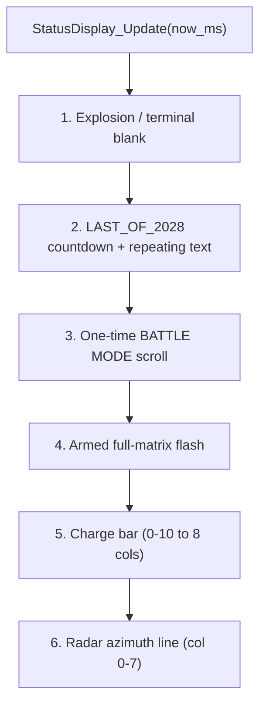

# Task 2 - Matrix Status Controller

## Context

Build a non-blocking display arbiter on top of the Task 1 driver ([App/Inc/ht16k33.h](App/Inc/ht16k33.h)), following the same STM32 HAL style (`HAL_StatusTypeDef`, `HAL_GetTick`, no `HAL_Delay`). It owns all matrix state and, each `StatusDisplay_Update(now_ms)`, renders the single highest-priority screen.

### Priority (from Darren's Tasks + Assignment2 brief)


## New files

- `App/Inc/status_display.h` - handle, mode enum, public API
- `App/Src/status_display.c` - arbitration, rendering, compact font, scrolling
- `App/Test/status_display_test.c` - UART menu + value injection + auto sequence

## API design (`status_display.h`)

```c
#include "ht16k33.h"

/* Mode/screen enum - highest active one wins (higher value = higher priority) */
typedef enum {
    STATUS_SCREEN_BLANK = 0,
    STATUS_SCREEN_RADAR,        /* azimuth line */
    STATUS_SCREEN_CHARGE,       /* 0-10 progress bar */
    STATUS_SCREEN_ARMED,        /* full-matrix flash */
    STATUS_SCREEN_BATTLE_TEXT,  /* one-shot BATTLE MODE scroll */
    STATUS_SCREEN_LAST_2028,    /* repeating LAST OF 2028 + countdown */
    STATUS_SCREEN_EXPLOSION     /* explosion frame then blank */
} StatusScreen_t;

typedef struct {
    HT16K33_HandleTypeDef *dev;
    /* injected state */
    uint8_t  charge;        /* 0-10 */
    uint8_t  azimuth;       /* 0-7, 0xFF = none */
    uint8_t  armed;         /* bool */
    /* battle one-shot */
    uint8_t  battle_active;
    uint32_t battle_start_ms;
    /* last-of-2028 */
    uint8_t  last_active;
    uint8_t  countdown_on;
    uint8_t  countdown_val;   /* 9..0 */
    uint32_t countdown_start_ms;
    /* terminal */
    uint8_t  explosion_active;
    uint32_t explosion_start_ms;
    uint8_t  terminated;
    /* animation */
    uint16_t scroll_col;
    uint32_t last_step_ms;
    StatusScreen_t last_drawn;
} StatusDisplay_HandleTypeDef;

void StatusDisplay_Init(StatusDisplay_HandleTypeDef *h, HT16K33_HandleTypeDef *dev);

/* value injection (mandatory basics) */
void StatusDisplay_SetCharge (StatusDisplay_HandleTypeDef *h, uint8_t charge_0_10);
void StatusDisplay_SetArmed  (StatusDisplay_HandleTypeDef *h, uint8_t armed);
void StatusDisplay_SetAzimuth(StatusDisplay_HandleTypeDef *h, uint8_t col_0_7); /* 0xFF clears */

/* mode transitions / events */
void StatusDisplay_EnterBattle    (StatusDisplay_HandleTypeDef *h); /* triggers one scroll */
void StatusDisplay_EnterLastOf2028(StatusDisplay_HandleTypeDef *h); /* repeating text + 10s countdown */
void StatusDisplay_Rescue         (StatusDisplay_HandleTypeDef *h); /* cancel countdown, back to battle */
void StatusDisplay_TriggerExplosion(StatusDisplay_HandleTypeDef *h);
void StatusDisplay_Reset          (StatusDisplay_HandleTypeDef *h); /* back to standby/blank */

/* drive from main loop; redraws only on change/animation tick */
HAL_StatusTypeDef StatusDisplay_Update(StatusDisplay_HandleTypeDef *h, uint32_t now_ms);

/* test harness */
void StatusDisplay_Test_Init(StatusDisplay_HandleTypeDef *h,
                             HT16K33_HandleTypeDef *dev,
                             UART_HandleTypeDef *huart);
void StatusDisplay_Test_Update(uint32_t now_ms);
```

## Rendering details (`status_display.c`)

- **Charge bar:** map 0-10 to 0-8 lit columns (`cols = (charge*8 + 5)/10`), fill from bottom rows or left columns; render row-major `uint8_t frame[8]`.
- **Armed flash:** toggle full `0xFF`/`0x00` at ~4 Hz using `now_ms`.
- **Radar azimuth:** single vertical line at column `azimuth` (all 8 rows set in that column).
- **BATTLE MODE scroll:** scroll once left-to-right; when `scroll_col` passes end, clear `battle_active`, resume lower-priority screen.
- **LAST OF 2028:** scroll text repeatedly; overlay/alternate with countdown digits `9..0` derived from `countdown_start_ms` (1 s/step). At 0 -> auto `explosion_active`.
- **Explosion:** show expanding/explosion frame for ~1 s, then set `terminated` and render blank.
- **Compact font:** column-encoded glyph table (each char = up to 6 columns, 8 rows). Characters needed: `A B D E F L M O S T` + space + digits `0-9`. Build a wide column buffer for scrolling, then transpose an 8-column window into the row-major `frame[8]` for `HT16K33_WriteFrame`.
- **Redraw policy:** only call `HT16K33_WriteFrame` when the computed frame changes or on an animation tick, to avoid I2C spam.

## Test harness (`status_display_test.c`)

Non-blocking UART menu over the injected `UART_HandleTypeDef` (default `huart1` = ST-LINK VCP). Each `StatusDisplay_Test_Update(now_ms)`:
1. Poll one byte: `HAL_UART_Receive(huart, &ch, 1, 0)` (returns `HAL_OK` only if a key is waiting).
2. Act on the key, echo state over UART.
3. Call `StatusDisplay_Update(h, now_ms)`.

Menu keys:
- `+` / `-` : charge up / down (0-10)
- `r` : cycle azimuth 0..7 then off
- `f` : toggle armed flash
- `b` : BATTLE MODE one-shot scroll
- `l` : enter LAST OF 2028 (text + 10 s countdown)
- `z` : rescue (cancel countdown -> battle)
- `x` : trigger explosion now
- `0` : reset to standby/blank
- `s` : run full auto sequence (scripted timeline injecting every screen in priority order, demonstrating arbitration, then returns to menu)
- `h` : reprint menu

The auto sequence (`s`) is an internal mini state machine stepped by `now_ms`: charge ramp -> armed flash -> BATTLE scroll -> radar sweep -> enter LAST OF 2028 -> countdown 9..0 -> explosion -> blank -> back to idle.

## Integration (lab project)

Mirror the Task 1 approach so it builds and flashes:
- Copy `status_display.c` + `status_display_test.c` into `C:\Users\darre\STM32CubeIDE\workspace_1.19.0\EE2028_Project_Test\Core\Src`, and `status_display.h` into `Core\Inc`.
- In `Core/Src/main.c` USER CODE blocks: declare `StatusDisplay_HandleTypeDef hstatus;`, call `StatusDisplay_Test_Init(&hstatus, &hmatrix, &huart1);` after inits, and `StatusDisplay_Test_Update(HAL_GetTick());` in the loop (replacing the Task 1 `HT16K33_Test_Update`).
- Build and flash; drive via a serial terminal on COM6 @ 115200.

## Checklist (Task 2)

- 0-10 charge -> 8-column bar
- Full-matrix armed flashing
- Radar azimuth -> column 0-7
- Scroll BATTLE MODE once on entry
- Repeating LAST OF 2028 text
- Countdown 9->0 (or shrinking bar)
- Explosion frame then blank
- Compact 8x8 font, required chars only
- Priority arbitration enforced
- All timing via `now_ms` / `HAL_GetTick`, no `HAL_Delay`
- Test code injects values and steps modes via UART menu + auto sequence
