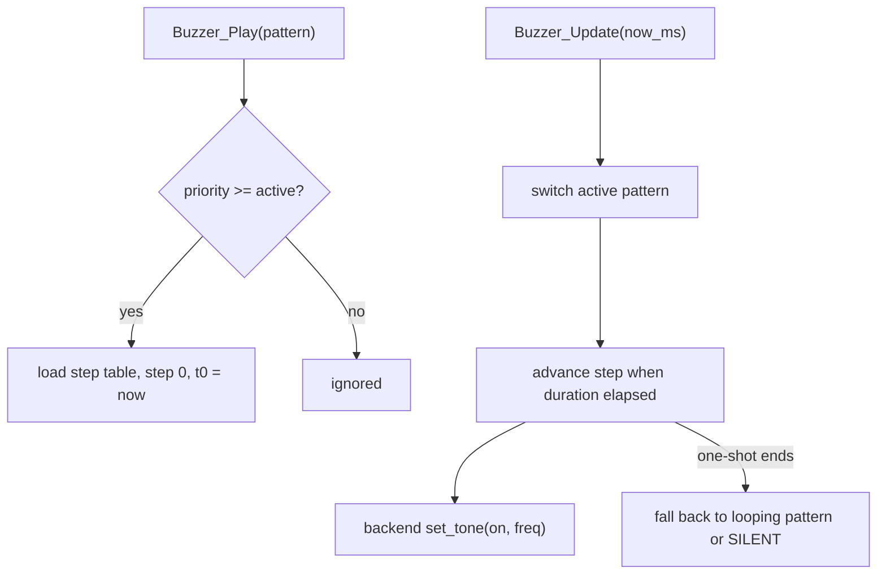

# Buzzer Design

Task 3 implementation for the Grove buzzer enhancement.

**Status:** Task 3 is **complete and hardware-verified** (active buzzer on D2; rhythm patterns confirmed).

## Context

From [docs/Darren's_Tasks.md](Darren's_Tasks.md) Task 3 and [docs/Assignment2_Enhancements.md](Assignment2_Enhancements.md), the buzzer needs six behaviours: threat chirp, laser-fire, 2 Hz LAST_OF_2028 warning, accelerating countdown beeps, final burst, then silence. Same style as Task 2: pure logic, `Buzzer_Update(now_ms)`, no `HAL_Delay`.

Hardware facts:

- Buzzer on **D2 = PD14** (`ARD_D2_Pin` / `ARD_D2_GPIO_Port` in the lab `main.h`).
- CubeMX configures PD14 as an **EXTI rising input**; the test harness re-inits it as push-pull output (USER CODE / `Buzzer_Test_Init`), default LOW. No `.ioc` edit.
- **Hardware confirmed active** (fixed pitch). Patterns are ON/OFF rhythms only. PWM/`TIM4_CH3` is not used.

## Scope

- Non-blocking pattern engine driven by `Buzzer_Update(now_ms)`.
- Enum + switch-case based mode handling.
- Hardware-neutral tone backend callback.
- Active Grove buzzer on `ARD_D2` (`PD14`) — no PWM / pitch control.

## Files

- [App/Inc/buzzer.h](../App/Inc/buzzer.h) — enum, step struct, backend, handle, API
- [App/Src/buzzer.c](../App/Src/buzzer.c) — step tables, arbiter, switch-case update
- [App/Inc/buzzer_test.h](../App/Inc/buzzer_test.h) — UART test hooks
- [App/Test/buzzer_test.c](../App/Test/buzzer_test.c) — GPIO backend on PD14 + key handler

Lab copies synced to:

- `C:/Users/darre/STM32CubeIDE/workspace_1.19.0/EE2028_Project_Test/Core/Inc`
- `C:/Users/darre/STM32CubeIDE/workspace_1.19.0/EE2028_Project_Test/Core/Src`

## Pattern model

```c
typedef enum {           /* higher value = higher priority */
    BUZZER_PATTERN_SILENT = 0,
    BUZZER_PATTERN_THREAT_CHIRP,   /* one-shot: double tap */
    BUZZER_PATTERN_LASER_FIRE,     /* one-shot: stutter + hold (“pew”) */
    BUZZER_PATTERN_LAST_WARNING,   /* loop: 2 Hz, 250 on / 250 off */
    BUZZER_PATTERN_COUNTDOWN,      /* loop: gap shrinks with value 10..0 */
    BUZZER_PATTERN_FINAL_BURST,    /* one-shot: accelerating burst, then latch silent */
    BUZZER_PATTERN_COUNT
} BuzzerPattern_t;
```

Each fixed pattern is a const step table `{ on, freq_hz, duration_ms }` plus a `loop` flag. `freq_hz` is kept for API compatibility but is **0 / ignored** by the GPIO backend.

`Buzzer_Update` uses a `switch (active_pattern)` for special cases (`COUNTDOWN` computes gap from countdown value; `FINAL_BURST` latches silent) and a shared step-walker for the rest.



## Public API

```c
void Buzzer_Init(Buzzer_HandleTypeDef *h, const Buzzer_Backend_t *backend);
void Buzzer_Play(Buzzer_HandleTypeDef *h, BuzzerPattern_t pattern);
void Buzzer_SetCountdown(Buzzer_HandleTypeDef *h, uint8_t value_0_10);
void Buzzer_Stop(Buzzer_HandleTypeDef *h);
void Buzzer_Reset(Buzzer_HandleTypeDef *h);
void Buzzer_Update(Buzzer_HandleTypeDef *h, uint32_t now_ms);
```

## Active-buzzer rhythms (as built)

| Pattern | Rhythm |
| ------- | ------ |
| Threat chirp | Double tap: `ON 60` → `OFF 70` → `ON 60` |
| Laser fire | “Pew”: three stutters then hold — `ON 40` / `OFF 30` ×3 → `ON 180` |
| LAST warning | 2 Hz loop: `ON 250` → `OFF 250` |
| Countdown | Beep `ON 60`; gap `60 + value×80` ms (`value` = 10..0, faster near 0) |
| Final burst | Accelerating pulses → long `ON 250`, then latched silence |

## Arbitration and state model

- Looping base pattern tracked separately (`SILENT`, `LAST_WARNING`, `COUNTDOWN`).
- One-shots (`THREAT_CHIRP`, `LASER_FIRE`, `FINAL_BURST`) start only if priority ≥ current active.
- When a one-shot ends, controller resumes the looping base pattern.
- `FINAL_BURST` latches silent until `Buzzer_Reset`.
- `Buzzer_Stop` immediately forces silent (rescue).
- `Buzzer_SetCountdown(h, value_0_10)` updates countdown cadence live.

## Hardware-neutral backend

```c
typedef struct {
    void (*set_tone)(void *ctx, uint8_t on, uint16_t freq_hz); /* freq ignored if active */
    void *ctx;
} Buzzer_Backend_t;
```

Current test backend:

- Re-inits `PD14` (`ARD_D2`) as GPIO output push-pull, default LOW.
- `HAL_GPIO_WritePin` for on/off.
- Backend called only on state change (no GPIO spam).
- PWM / pitch path not used with this SKU.

## Test harness

`buzzer_test.c` re-inits PD14 as output LOW. Keys are owned by the status-display UART reader and forwarded via `Buzzer_Test_HandleKey(ch)` from `StatusDisplay_Test_Update`’s default case (single UART owner).

| Key | Action |
| --- | ------ |
| `t` | Tone probe ON for 1 s |
| `c` | Threat chirp (double tap) |
| `w` | LAST warning loop (2 Hz) |
| `k` | Countdown 10..0 demo |
| `F` | Laser fire “pew” (**uppercase**) |
| `X` | Final burst (**uppercase**) |
| `Z` | Stop / silent (**uppercase**) |

Uppercase `F`/`X`/`Z` avoid collisions with matrix keys `f`/`x`/`z`.

## Integration (lab project)

- Copy into `EE2028_Project_Test/Core/Src` and `Core/Inc`; list in `Debug/Core/Src/subdir.mk` and `objects.list`.
- `Buzzer_Test_Init` runs from `StatusDisplay_Test_Init`; `Buzzer_Test_Update` runs each loop tick.
- Build/flash in CubeIDE; serial: `.\scripts\serial_monitor.ps1` (COM6 @ 115200).

## Checklist

- [x] Hardware-neutral backend callback
- [x] Threat chirp, laser fire, 2 Hz warning, accelerating countdown, final burst + silence
- [x] Priority arbitration via enum; special cases via switch-case
- [x] Non-blocking `Buzzer_Update(now_ms)`
- [x] Active buzzer on PD14 verified; rhythm-only (no PWM pitch)
