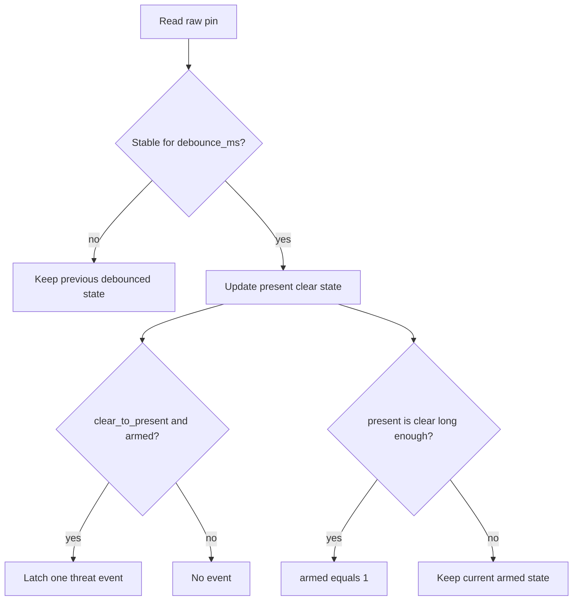

# IR Threat Design

Task 4 implementation for the Grove infrared reflective sensor enhancement.

**Status:** Task 4 is **complete and hardware-verified** (Grove IR reflective on D3; approach/clear events and threat chirp confirmed).

## Context

From [docs/Darren's_Tasks.md](Darren's_Tasks.md) Task 4 and [docs/Assignment2_Enhancements.md](Assignment2_Enhancements.md), IR is a low-complexity threat trigger:

- detect close reflective object (hand/card)
- emit one clean threat event per encounter
- avoid event spam while object remains present
- re-arm after clear

Like Task 2/3, the module is non-blocking and tick-driven (`IR_Update(now_ms)`), with no `HAL_Delay`.

## Hardware facts

- Module: Grove Infrared Reflective Sensor
- Output type: digital
- Board pin: Arduino D3 (Discovery mapping expected as `ARD_D3_Pin`/`ARD_D3_GPIO_Port`)
- Test harness mode: input + pull-up
- Active polarity: configurable (`active_level`); **confirmed active-LOW (`0`)** on this Grove module

Notes:

- IR is enhancement-only and must not modify mandatory PB/sensor behavior.

## Scope

- Hardware-neutral read callback backend
- Debounce logic for raw input transitions
- One-shot threat edge latch (clear -> present)
- Re-arm after sustained clear
- Simple test harness with UART status and simulated trigger key
- Command Center-friendly event text (`EVT IR=1` / `EVT IR=0`)

## Files

- [App/Inc/ir_threat.h](../App/Inc/ir_threat.h)
- [App/Src/ir_threat.c](../App/Src/ir_threat.c)
- [App/Inc/ir_threat_test.h](../App/Inc/ir_threat_test.h)
- [App/Test/ir_threat_test.c](../App/Test/ir_threat_test.c)
- [App/Test/status_display_test.c](../App/Test/status_display_test.c) (menu + routing + periodic update)

## Core model

### Backend

```c
typedef struct {
    uint8_t (*read_raw)(void *ctx); /* returns raw 0/1 */
    void *ctx;
} IR_Backend_t;
```

### Config

```c
typedef struct {
    uint8_t active_level;  /* raw level that means present */
    uint16_t debounce_ms;  /* stable-time requirement */
    uint16_t rearm_ms;     /* clear hold before next event */
} IR_Config_t;
```

### API

```c
void IR_Init(IR_HandleTypeDef *h, const IR_Backend_t *backend, const IR_Config_t *cfg);
void IR_Reset(IR_HandleTypeDef *h);
void IR_Update(IR_HandleTypeDef *h, uint32_t now_ms);
uint8_t IR_PollThreat(IR_HandleTypeDef *h); /* one-shot event */
uint8_t IR_IsPresent(const IR_HandleTypeDef *h);
uint8_t IR_ReadRaw(const IR_HandleTypeDef *h);
```

### State flow



Rules:

- Threat event triggers once per encounter.
- Holding object in place does not retrigger.
- New event possible only after clear persists for `rearm_ms`.

## Default timing (as implemented)

- `debounce_ms = 30`
- `rearm_ms = 300`

Tune these values after bench testing distance/noise in your lab setup.

## Test harness behavior

`IR_Test_Init()`:

- re-inits `ARD_D3` as `GPIO_MODE_INPUT`, `GPIO_PULLUP`
- uses GPIO backend `HAL_GPIO_ReadPin`
- initializes IR with active-LOW default

UART menu additions in status-display test:

- `i` -> print IR raw/present/armed state
- `I` -> simulate IR threat event

Update behavior:

- prints `EVT IR=1` on debounced present
- prints `EVT IR=0` on debounced clear
- on threat event, prints `EVT THREAT source=IR` and triggers buzzer threat chirp

## Integration notes

- `StatusDisplay_Test_Update()` keeps one UART owner and routes unknown keys:
  - IR first (`IR_Test_HandleKey`)
  - then buzzer (`Buzzer_Test_HandleKey`)
- `IR_Test_Update(now_ms)` runs once per loop tick, non-blocking.

## Lab sync (CubeIDE project)

Copy these into the lab project and include them in build files:

- `Core/Inc/ir_threat.h`
- `Core/Inc/ir_threat_test.h`
- `Core/Src/ir_threat.c`
- `Core/Src/ir_threat_test.c`

Also ensure `status_display_test.c` include/routing changes are present.

## Checklist

- [x] Hardware-neutral backend callback
- [x] Non-blocking debounce + one-event latch + re-arm
- [x] UART test keys (`i`, `I`) and event lines
- [x] Buzzer chirp on threat event
- [x] Bench-confirm active polarity and detection distance
- [x] Debounce/re-arm defaults (`30` / `300` ms) verified on hardware
