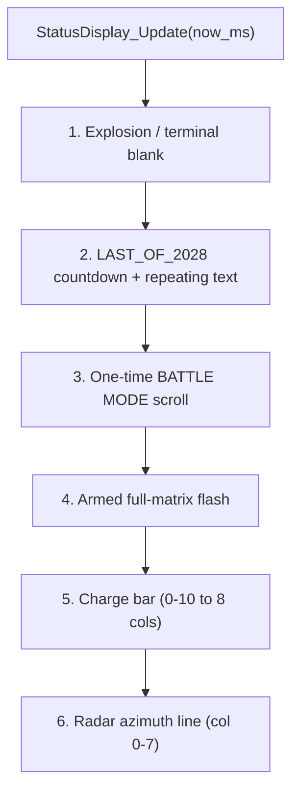

# LED Matrix Design — Driver & Status Controller

Documentation for the HT16K33 8×8 matrix stack used in Darren’s enhancement work.

**Status:** Task 1 (driver) and Task 2 (status controller) are **complete and hardware-verified** (display confirmed working).

Sources:

1. Plan: **HT16K33 Matrix Driver** (Task 1)
2. Plan: **Matrix Status Controller** (Task 2)
3. As-built notes from bring-up and tuning (this chat)

Canonical source files live under `App/`. Lab copies are synced into the CubeIDE project `EE2028_Project_Test` (`Core/Inc`, `Core/Src`) for build/flash.

---

# 1) LED Matrix Driver

> Copied from plan: HT16K33 Matrix Driver

## Context

The HT16K33 is an I2C LED controller (default address `0x70`). The driver follows STM32 HAL conventions throughout: `HAL_StatusTypeDef` for return values, `HAL_I2C_Master_Transmit` for bus access, `HAL_GetTick` for timing, and CubeIDE-style include guards and type naming.

Existing code lives in `Core/Src/main.c` and `Core/Inc/drone.h` — we do **not** touch these for the driver itself. New files go under `App/`.

## New files

- `App/Inc/ht16k33.h` — public API, types, and constants
- `App/Src/ht16k33.c` — implementation
- `App/Test/ht16k33_test.c` — tick-based hardware smoke test (non-blocking, uses `HAL_GetTick`)

## API design (HAL-style)

```c
#include "stm32l4xx_hal.h"          /* official HAL header for types and I2C */

/* Default I2C address (7-bit, left-shifted for HAL) */
#define HT16K33_I2C_ADDR_DEFAULT  (0x70 << 1)
#define HT16K33_I2C_TIMEOUT       100U   /* ms */

/* Device handle — injectable I2C peripheral and address */
typedef struct {
    I2C_HandleTypeDef *hi2c;       /* from CubeMX, e.g. &hi2c1 */
    uint16_t           addr;       /* 8-bit (left-shifted) address for HAL */
} HT16K33_HandleTypeDef;

/* All functions return HAL_StatusTypeDef (HAL_OK / HAL_ERROR / HAL_BUSY / HAL_TIMEOUT) */
HAL_StatusTypeDef HT16K33_Init(HT16K33_HandleTypeDef *hdev,
                               I2C_HandleTypeDef *hi2c, uint16_t addr);
HAL_StatusTypeDef HT16K33_SetBrightness(HT16K33_HandleTypeDef *hdev, uint8_t level);
HAL_StatusTypeDef HT16K33_SetBlinkRate(HT16K33_HandleTypeDef *hdev, uint8_t rate);
HAL_StatusTypeDef HT16K33_Clear(HT16K33_HandleTypeDef *hdev);
HAL_StatusTypeDef HT16K33_WriteFrame(HT16K33_HandleTypeDef *hdev,
                                     const uint8_t frame[8]);
```

Key HAL-alignment decisions:

- **`HAL_StatusTypeDef`** return type everywhere — no custom enum; matches every other HAL driver
- **Handle struct named `*_HandleTypeDef`** — follows `I2C_HandleTypeDef`, `UART_HandleTypeDef` pattern
- **Address stored left-shifted (8-bit)** — matches `HAL_I2C_Master_Transmit` expectation directly
- **`HAL_I2C_Master_Transmit(hdev->hi2c, hdev->addr, ...)`** — the official HAL I2C transmit call
- **`#include "stm32l4xx_hal.h"`** — official CubeIDE HAL header, same as `drone.h`

## I2C protocol (HT16K33 datasheet)

- System oscillator on: transmit `0x21`
- Display on, blink off: transmit `0x81`
- Display on, blink rate N (0-3): transmit `0x81 | (rate << 1)`
- Brightness 0-15: transmit `0xE0 | level`
- Write display RAM: transmit 17 bytes — `0x00` (RAM start address) followed by 16 data bytes (8 rows × 2 bytes each; second byte of each pair is `0x00` for 8×8 matrix)

## Planned implementation details

- **`HT16K33_Init`**: store handle and address, then sequentially call `HAL_I2C_Master_Transmit` for oscillator-on, display-on, default brightness (max), and clear. Propagate the first non-`HAL_OK` status.
- **`HT16K33_WriteFrame`**: pack `frame[8]` into 17-byte buffer (`0x00` + interleaved row/`0x00` pairs), transmit with `HAL_I2C_Master_Transmit`.
- **`HT16K33_Clear`**: call `WriteFrame` with an all-zeros frame.
- **`HT16K33_SetBrightness`**: clamp to 0-15, transmit `0xE0 | level`.
- **`HT16K33_SetBlinkRate`**: clamp to 0-3, transmit `0x81 | (rate << 1)`.
- All timeouts use `HT16K33_I2C_TIMEOUT` (100 ms).

## Hardware smoke test

`App/Test/ht16k33_test.c` provides:

```c
void HT16K33_Test_Init(HT16K33_HandleTypeDef *hdev);
uint8_t HT16K33_Test_Update(uint32_t now_ms);  /* returns 1 when test complete */
```

Test sequence (non-blocking, driven by `HAL_GetTick`):

1. Light one pixel at a time (row sweep)
2. Light one full row at a time
3. Light one full column at a time
4. Clear — return complete

No `HAL_Delay()` — uses elapsed-time checks only.

## Folder structure after Task 1

```
App/
  Inc/
    ht16k33.h
  Src/
    ht16k33.c
  Test/
    ht16k33_test.c
```

## Checklist (from Darren's Tasks)

- Injectable I2C handle/address (not hard-coded `hi2c2`)
- Return `HAL_StatusTypeDef` to the caller
- Frame data independent from HAL (plain `uint8_t[8]`)
- Accepts an 8×8 bitmap and sends it to the HT16K33
- Hardware test for pixel/row/column sweep
- Uses official STM32 HAL I2C API and type conventions throughout

---

# 2) Matrix Status Controller

> Copied from plan: Matrix Status Controller

## Context

Build a non-blocking display arbiter on top of the Task 1 driver (`App/Inc/ht16k33.h`), following the same STM32 HAL style (`HAL_StatusTypeDef`, `HAL_GetTick`, no `HAL_Delay`). It owns all matrix state and, each `StatusDisplay_Update(now_ms)`, renders the single highest-priority screen.

### Priority (from Darren's Tasks + Assignment 2 brief)



## New files

- `App/Inc/status_display.h` — handle, mode enum, public API
- `App/Src/status_display.c` — arbitration, rendering, compact font, scrolling
- `App/Test/status_display_test.c` — UART menu + value injection + auto sequence

## API design (`status_display.h`)

```c
#include "ht16k33.h"

/* Mode/screen enum - highest active one wins (higher value = higher priority) */
typedef enum {
    STATUS_SCREEN_BLANK = 0,
    STATUS_SCREEN_RADAR,        /* azimuth line */
    STATUS_SCREEN_CHARGE,       /* 0-10 progress bar */
    STATUS_SCREEN_ARMED,        /* full-matrix flash */
    STATUS_SCREEN_BATTLE_TEXT,  /* one-shot BATTLE MODE scroll */
    STATUS_SCREEN_LAST_2028,    /* repeating LAST OF 2028 + countdown */
    STATUS_SCREEN_EXPLOSION     /* explosion frame then blank */
} StatusScreen_t;

typedef struct {
    HT16K33_HandleTypeDef *dev;
    /* injected state */
    uint8_t  charge;        /* 0-10 */
    uint8_t  azimuth;       /* 0-7, 0xFF = none */
    uint8_t  armed;         /* bool */
    /* battle one-shot */
    uint8_t  battle_active;
    uint32_t battle_start_ms;
    /* last-of-2028 */
    uint8_t  last_active;
    uint8_t  countdown_on;
    uint8_t  countdown_val;   /* 9..0 */
    uint32_t countdown_start_ms;
    /* terminal */
    uint8_t  explosion_active;
    uint32_t explosion_start_ms;
    uint8_t  terminated;
    /* animation */
    uint16_t scroll_col;
    uint32_t last_step_ms;
    StatusScreen_t last_drawn;
} StatusDisplay_HandleTypeDef;

void StatusDisplay_Init(StatusDisplay_HandleTypeDef *h, HT16K33_HandleTypeDef *dev);

/* value injection (mandatory basics) */
void StatusDisplay_SetCharge (StatusDisplay_HandleTypeDef *h, uint8_t charge_0_10);
void StatusDisplay_SetArmed  (StatusDisplay_HandleTypeDef *h, uint8_t armed);
void StatusDisplay_SetAzimuth(StatusDisplay_HandleTypeDef *h, uint8_t col_0_7); /* 0xFF clears */

/* mode transitions / events */
void StatusDisplay_EnterBattle    (StatusDisplay_HandleTypeDef *h); /* triggers one scroll */
void StatusDisplay_EnterLastOf2028(StatusDisplay_HandleTypeDef *h); /* repeating text + 10s countdown */
void StatusDisplay_Rescue         (StatusDisplay_HandleTypeDef *h); /* cancel countdown, back to battle */
void StatusDisplay_TriggerExplosion(StatusDisplay_HandleTypeDef *h);
void StatusDisplay_Reset          (StatusDisplay_HandleTypeDef *h); /* back to standby/blank */

/* drive from main loop; redraws only on change/animation tick */
HAL_StatusTypeDef StatusDisplay_Update(StatusDisplay_HandleTypeDef *h, uint32_t now_ms);

/* test harness */
void StatusDisplay_Test_Init(StatusDisplay_HandleTypeDef *h,
                             HT16K33_HandleTypeDef *dev,
                             UART_HandleTypeDef *huart);
void StatusDisplay_Test_Update(uint32_t now_ms);
```

## Planned rendering details (`status_display.c`)

- **Charge bar:** map 0-10 to 0-8 lit columns (`cols = (charge*8 + 5)/10`), fill from left columns; render row-major `uint8_t frame[8]`.
- **Armed flash:** toggle full `0xFF`/`0x00` using `now_ms`.
- **Radar azimuth:** single vertical line at column `azimuth` (all 8 rows set in that column).
- **BATTLE MODE scroll:** scroll once left-to-right; when `scroll_col` passes end, clear `battle_active`, resume lower-priority screen.
- **LAST OF 2028:** scroll text repeatedly; overlay/alternate with countdown digits `9..0` derived from `countdown_start_ms` (1 s/step). At 0 → auto `explosion_active`.
- **Explosion:** show expanding/explosion frame, then set `terminated` and render blank.
- **Compact font:** column-encoded glyph table (each char = up to 6 columns, 8 rows). Characters needed: `A B D E F L M O S T` + space + digits `0-9`.
- **Redraw policy:** only call `HT16K33_WriteFrame` when the computed frame changes or on an animation tick, to avoid I2C spam.

## Test harness (`status_display_test.c`)

Non-blocking UART menu over the injected `UART_HandleTypeDef` (default `huart1` = ST-LINK VCP). Each `StatusDisplay_Test_Update(now_ms)`:

1. Poll one byte: `HAL_UART_Receive(huart, &ch, 1, 0)` (returns `HAL_OK` only if a key is waiting).
2. Act on the key, echo state over UART.
3. Call `StatusDisplay_Update(h, now_ms)`.

Planned menu keys:

- `+` / `-` : charge up / down (0-10)
- `r` : cycle azimuth 0..7 then off
- `f` : toggle armed flash
- `b` : BATTLE MODE one-shot scroll
- `l` : enter LAST OF 2028 (text + 10 s countdown)
- `z` : rescue (cancel countdown → battle)
- `x` : trigger explosion now
- `0` : reset to standby/blank
- `s` : run full auto sequence
- `h` : reprint menu

The auto sequence (`s`) is an internal mini state machine stepped by `now_ms`: charge ramp → armed flash → BATTLE scroll → radar sweep → enter LAST OF 2028 → countdown → explosion → blank → idle.

## Integration (lab project)

- Copy sources into `EE2028_Project_Test\Core\Src` / `Core\Inc`.
- In `main.c` USER CODE: `StatusDisplay_Test_Init(...)` after inits; `StatusDisplay_Test_Update(HAL_GetTick())` in the loop.
- Serial: COM6 @ 115200 (helper script: `scripts/serial_monitor.ps1`).

## Checklist (Task 2) — complete

- [x] 0-10 charge → 8-column bar
- [x] Full-matrix armed flashing
- [x] Radar azimuth → column 0-7 (+ optional dial)
- [x] Scroll BATTLE MODE once on entry
- [x] Repeating LAST OF EE2028 text
- [x] Countdown 10→0 with progressive flash
- [x] Explosion frame then blank
- [x] Compact 8×8 font, required chars only
- [x] Priority arbitration enforced
- [x] All timing via `now_ms` / `HAL_GetTick`, no `HAL_Delay`
- [x] Test code injects values and steps modes via UART menu + auto sequence
- [x] Hardware display verified

---

# 3) As-built implementation details

Notes below reflect what was actually implemented and tuned after the plans. Prefer this section over the plan text where they differ.

## 3.1 Frame coordinate convention

Logical frame layout presented to `HT16K33_WriteFrame`:

- `frame[row]`, `row = 0` at the **top**
- Bit `col` of each row byte is logical column `col`, with bit 0 = **left**

Grove/Adafruit-style HT16K33 packs wire physical column 0 to COM bit 7. The driver therefore **bit-reverses each row byte** before I2C transmit so glyphs are not laterally mirrored:

```c
tx[1 + row*2] = HT16K33_ReverseBits(frame[row]);
tx[2 + row*2] = 0x00;
```

## 3.2 Driver files (as built)

| File | Role |
|------|------|
| `App/Inc/ht16k33.h` | Handle + Init / brightness / blink / clear / WriteFrame + test hooks |
| `App/Src/ht16k33.c` | HAL I2C commands + bit-reversed frame packing |
| `App/Test/ht16k33_test.c` | Non-blocking pixel → row → column sweep |

Hardware-verified on the Discovery board via the lab CubeIDE project.

## 3.3 Controller files (as built)

| File | Role |
|------|------|
| `App/Inc/status_display.h` | Screens, radar style enum, handle, public API |
| `App/Src/status_display.c` | Priority arbiter, font, all renderers |
| `App/Test/status_display_test.c` | UART menu + auto sequence |

Extra vs original plan API:

- `StatusRadarStyle_t` / `radar_style` field
- `StatusDisplay_SetRadarStyle(...)`
- `dirty` flag for redraw coalescing

## 3.4 Priority (unchanged)

Still resolved in `ResolveScreen()`:

1. Explosion / terminal blank  
2. LAST_OF_2028 sequence  
3. One-time BATTLE MODE scroll  
4. Armed flash  
5. Charge bar  
6. Radar (line or dial)  
7. Blank  

Mode enum name remains **`LAST_OF_2028`** (not any `TEST_OF_*` variant).

## 3.5 LAST OF EE2028 sequence (tuned)

Banner string is **`LAST OF EE2028`** (not `LAST OF 2028`).

On `StatusDisplay_EnterLastOf2028()`:

1. **0–10 s** — repeating scrolling banner only (`countdown_on = 0`), stepped at `STATUS_LAST_SCROLL_MS` (50 ms/column)
2. **10–21 s** — digit countdown `10→0` (`countdown_on = 1`), LEDs flash on/off; half-period shortens as the value falls
3. **then** — explosion → blank / terminated

Constants:

- `STATUS_LAST_BANNER_MS = 10000`
- `STATUS_COUNTDOWN_MS = 11000` (digits 10..0 inclusive, 1 s each)
- `STATUS_LAST_SCROLL_MS = 50`
- `STATUS_COUNTDOWN_FLASH_MIN_MS = 40` (half-period at `0`)
- `STATUS_COUNTDOWN_FLASH_STEP_MS = 45` (added per remaining digit)

Flash half-period: `40 + countdown_val * 45` ms → ~490 ms at `10`, ~40 ms at `0`. Digit `10` is drawn as packed `1`+`0` (3+5 columns).

Rescue (`z`) cancels last/countdown/explosion and re-enters battle scroll.

## 3.6 Animation timings (tuned)

| Effect | Constant | Value |
|--------|----------|-------|
| Default / unused general scroll step | `STATUS_SCROLL_STEP_MS` | 120 ms |
| BATTLE MODE scroll step | `STATUS_BATTLE_SCROLL_MS` | 50 ms |
| LAST OF EE2028 banner scroll step | `STATUS_LAST_SCROLL_MS` | 50 ms |
| Countdown duration (10..0) | `STATUS_COUNTDOWN_MS` | 11000 ms |
| Countdown flash half-period at 0 | `STATUS_COUNTDOWN_FLASH_MIN_MS` | 40 ms |
| Countdown flash half-period step | `STATUS_COUNTDOWN_FLASH_STEP_MS` | 45 ms × val |
| Armed flash half-period | `STATUS_ARMED_FLASH_MS` | 50 ms (~10 Hz) |
| Explosion frame flip | `STATUS_EXPLOSION_FRAME_MS` | 40 ms |
| Explosion total duration | `STATUS_EXPLOSION_TOTAL_MS` | 400 ms |

No `HAL_Delay` anywhere; all advances use `now_ms` deltas.

## 3.7 Radar styles

Two styles share the same priority slot (`STATUS_SCREEN_RADAR`):

| Style | Behaviour |
|-------|-----------|
| `STATUS_RADAR_LINE` (default) | Full vertical column at azimuth `0..7` |
| `STATUS_RADAR_DIAL` | 180° needle; pivot at **bottom-edge centre** (cols 3–4, row 7); azimuth `0..7` sweeps **left → up → right**. Needle + pivot only (no arc). |

API: `StatusDisplay_SetRadarStyle(h, STATUS_RADAR_LINE | STATUS_RADAR_DIAL)`.

## 3.8 Font

Column-encoded glyphs for: space, `0–9`, `A B D E F L M O S T` (enough for `BATTLE MODE` and `LAST OF EE2028`).

Scrolling builds an 8-column window via `TextColumn` / `Draw_Column`, then packs into row-major `frame[8]`.

## 3.9 UART test menu (as built)

Serial: ST-LINK VCP, typically **COM6 @ 115200**. Helper: `scripts/serial_monitor.ps1`.

| Key | Action |
|-----|--------|
| `+` / `-` | Charge up / down (0–10) |
| `r` | Cycle radar azimuth 0..7 then off |
| `d` | Toggle radar dial ↔ line (clears charge/armed so radar is visible) |
| `f` | Toggle armed flash |
| `b` | BATTLE MODE one-shot scroll |
| `l` | LAST OF EE2028 (10 s banner → 10..0 flashing countdown → boom) |
| `z` | Rescue from LAST_OF_2028 |
| `x` | Trigger explosion now |
| `0` | Reset display state |
| `s` | Full auto sequence |
| `h` | Show menu |

Auto sequence (`s`): charge ramp → armed → battle → radar sweep → last (≈20 s) → explosion → done.

## 3.10 Lab integration

- Source of truth: `App/`
- Flash target copies: `C:\Users\darre\STM32CubeIDE\workspace_1.19.0\EE2028_Project_Test\Core\`
- `main.c` drives `StatusDisplay_Test_Init` / `StatusDisplay_Test_Update(HAL_GetTick())` in USER CODE regions
- CubeIDE Console ≠ serial monitor; use the PowerShell script or an external terminal on the VCP

## 3.11 Design invariants

- Enhancement modules stay out of friend’s CubeMX-owned files where possible; sync copies into the lab Core tree for bring-up.
- Display failures must not block mandatory drone logic once integrated.
- Frame buffer stays HAL-independent (`uint8_t[8]`) so PC-side unit tests remain possible.
- Naming: third drone mode is **`LAST_OF_2028`** / `Handle_Last_Of_2028_Mode` / “Last of 2028” in prose; matrix banner text may still read `LAST OF EE2028`.
