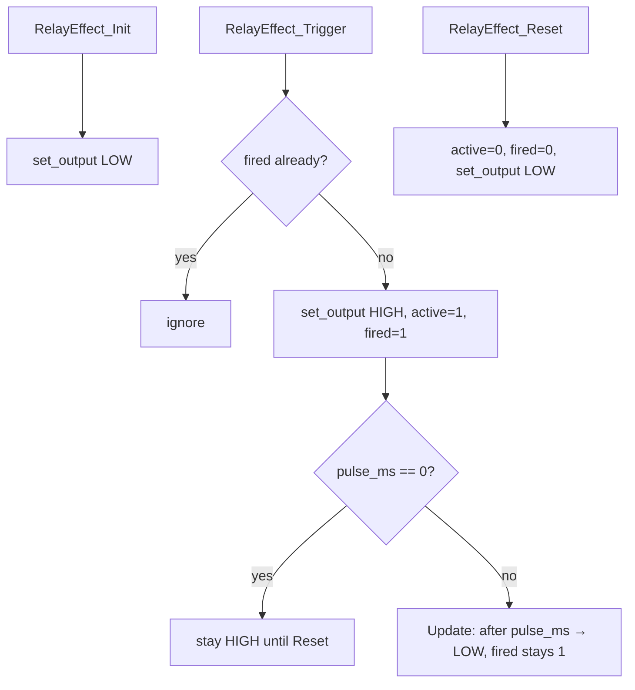

# Relay / Cap Explode Design

Task 5 implementation for the simulated capacitor blow-up enhancement (relay-module GPIO).

**Status:** Task 5 is **implemented** (logic + UART harness on D4). Bench-verify with an LED or relay control input before demo integration.

## Context

From [docs/Darren's_Tasks.md](Darren's_Tasks.md) Task 5 and [docs/Assignment2_Enhancements.md](Assignment2_Enhancements.md) enhancement **#3** (richer THE_LAST_OF_2028 / capacitor explode):

- At countdown `0` (or manual explosion), set `CAP_EXPLODE_Pin` **HIGH**
- Drive only a **relay module control input**, never a bare coil
- Switch only a safe, instructor-approved low-voltage simulation load
- Keep the pin **LOW** at init, rescue, and normal operation
- Do **not** rupture, short, or overcharge a physical capacitor

Same style as Task 2–4: pure logic, tick-driven `RelayEffect_Update(now_ms)`, no `HAL_Delay`.

## Hardware facts

- Signal name: `CAP_EXPLODE` (aliases `ARD_D4` in the test harness)
- Board of record: **B-L4S5I-IOT01A**
- Board pin: Arduino **D4 = PA3** (`ARD_D4_Pin` / `ARD_D4_GPIO_Port` in the lab Cube `main.h` / B-L4S5I-IOT01A `.ioc`)
- Mode: push-pull output, default **LOW**
- Neighbouring Arduino digital usage: **D2** = buzzer (PD14), **D3** = IR (PB0) — D4 is the next free Grove/Arduino digital
- CubeMX often already lists `ARD_D4` as an output; the harness re-inits it and writes LOW **before** `HAL_GPIO_Init` so reset cannot glitch HIGH

## Scope

- Hardware-neutral output backend callback
- Explicit `Trigger` / `Reset` APIs
- One-shot fire guard (countdown-zero cannot spam the relay every loop)
- Latched HIGH by default; optional timed pulse via `pulse_ms`
- UART test keys + Command Center–friendly event lines
- Hook from status-display explosion rising edge (no edit of mandatory `main.c`)

## Files

- [App/Inc/relay_effect.h](../App/Inc/relay_effect.h) — backend, config, handle, API
- [App/Src/relay_effect.c](../App/Src/relay_effect.c) — init/trigger/reset/update
- [App/Inc/relay_effect_test.h](../App/Inc/relay_effect_test.h) — UART + explosion hooks
- [App/Test/relay_effect_test.c](../App/Test/relay_effect_test.c) — GPIO backend on PA3 / D4
- [App/Test/status_display_test.c](../App/Test/status_display_test.c) — menu, edge detect, rescue path

Lab copies sync to (same pattern as buzzer/IR):

- `C:/Users/darre/STM32CubeIDE/workspace_1.19.0/EE2028_Project_Test/Core/Inc`
- `C:/Users/darre/STM32CubeIDE/workspace_1.19.0/EE2028_Project_Test/Core/Src`

## Core model

### Backend

```c
typedef struct {
    void (*set_output)(void *ctx, uint8_t high);
    void *ctx;
} Relay_Backend_t;
```

### Config

```c
typedef struct {
    /* 0 = latch HIGH until Reset; >0 = pulse then auto-LOW */
    uint16_t pulse_ms;
} Relay_Config_t;
```

### API

```c
void RelayEffect_Init(Relay_HandleTypeDef *h,
                      const Relay_Backend_t *backend,
                      const Relay_Config_t *cfg);
void RelayEffect_Trigger(Relay_HandleTypeDef *h, uint32_t now_ms);
void RelayEffect_Reset(Relay_HandleTypeDef *h);
void RelayEffect_Update(Relay_HandleTypeDef *h, uint32_t now_ms);
uint8_t RelayEffect_IsActive(const Relay_HandleTypeDef *h);
```

### State flow



Rules:

- `Trigger` fires **once** until `Reset` (latched terminal state).
- Default harness config: `pulse_ms = 0` → **latched HIGH** (matches “set `CAP_EXPLODE_Pin` HIGH”).
- Set `pulse_ms > 0` if the team prefers a timed pulse; `fired` still blocks retrigger until `Reset`.
- Backend is only driven from Init / Trigger / Reset / pulse expiry (no GPIO spam).

## Safety

| Rule | Why |
|------|-----|
| Drive relay **module input** only | MCU GPIO must not sink/source a bare coil |
| Safe low-voltage load only | No mains, no real capacitor rupture |
| Default and rescue keep pin **LOW** | Avoid accidental “boom” on boot or PB rescue |
| Write LOW before `HAL_GPIO_Init` | Prevents a HIGH glitch while the pin mode changes |

## Test harness behavior

`Relay_Test_Init()`:

- enables `GPIOA`, writes `CAP_EXPLODE` LOW, then configures push-pull output
- aliases `CAP_EXPLODE_Pin` → `ARD_D4_Pin` unless already defined
- initializes with `pulse_ms = 0` (latch)

UART menu additions in status-display test:

| Key | Action |
| --- | ------ |
| `e` | Manual `CAP_EXPLODE` HIGH (latched) |
| `E` | Manual `CAP_EXPLODE` LOW / reset |

Automatic hooks:

- Rising edge of `explosion_active` (countdown → 0 or matrix `x`) → `Relay_Test_OnExplosion()` → prints `EVT CAP_EXPLODE=1`
- Rescue `z` or reset `0` → `Relay_Test_OnRescue()` → prints `EVT CAP_EXPLODE=0`

## Integration notes

### Live adapter

- `main.c` calls `Enhancements_OnEvent(DRONE_EVENT_SELF_DESTRUCT_STARTED, …)` inside `Enter_Self_Destruct()`.
- Adapter → `Relay_Trigger` (defaults LOW at init; HIGH only on that event).
- `Enhancements_FinalEffectsDone` gates the permanent halt until explosion / final burst / relay pulse finish; `Enhancements_Shutdown` forces quiet / relay LOW.
- Compile with `-DEE_ENHANCEMENTS=1`. Pin: D4 / PA3 via `enhancements_hw.c`.

### Test harness

- `StatusDisplay_Test_Update()` key routing order: **relay** → IR → buzzer (single UART owner).
- `Relay_Test_Update(now_ms)` runs once per loop tick (needed only if `pulse_ms > 0`).
- Harness may print `EVT CAP_EXPLODE=` — harness-only; live path is GPIO via the adapter.
- Pair with matrix explosion frame + buzzer `FINAL_BURST` for the full demo effect.

## Lab sync (CubeIDE project)

Copy these into the lab project and include them in build files (`subdir.mk` / `objects.list`):

- `Core/Inc/relay_effect.h`
- `Core/Inc/relay_effect_test.h`
- `Core/Src/relay_effect.c`
- `Core/Src/relay_effect_test.c`

Also ensure `status_display_test.c` include / init / edge-detect / key-routing changes are present.

Build/flash in CubeIDE; serial: `.\scripts\serial_monitor.ps1` (COM6 @ 115200).

## Checklist

- [x] Hardware-neutral backend callback
- [x] Non-blocking Trigger / Reset / Update; init defaults LOW
- [x] One-shot fire guard; latched HIGH (`pulse_ms=0`) with optional pulse path
- [x] UART keys (`e` / `E`) and `EVT CAP_EXPLODE=` lines
- [x] Status-display explosion edge + rescue/reset wiring
- [x] Live adapter Trigger on `DRONE_EVENT_SELF_DESTRUCT_STARTED`
- [ ] Bench with LED (or relay module input) on D4 / PA3 on the linked Cube project
- [ ] Confirm no HIGH glitch across power-cycle / reset
- [ ] On-board verify with mandatory termination + enhancements enabled
